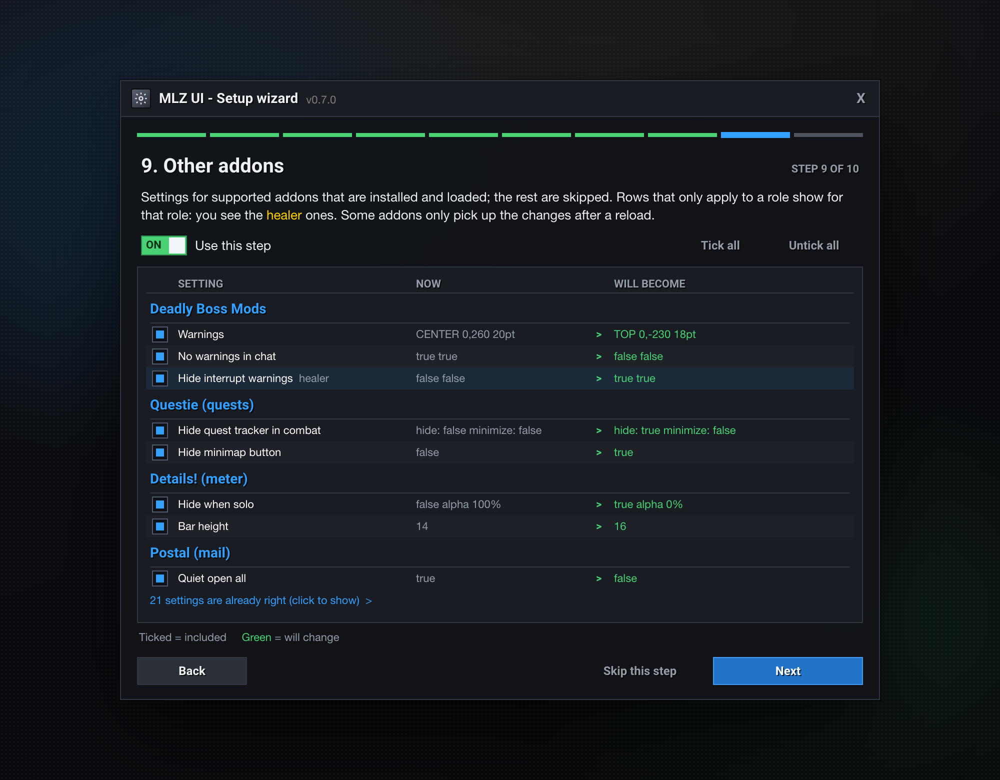

<div align="center">

# MLZ UI

**A clean, minimal World of Warcraft UI in one guided setup, built for WoW Forever and every class. Every change previewed, every change undoable.**


</div>

---

## Why MLZ UI

MLZ UI sets up the **Blizzard UI you already have** (Edit Mode, CVars, keybinds and your existing addons) instead of replacing it the way full UI suites do.

- **Preview first.** A setup wizard shows every change as *now → will become*. You pick what you want. It starts with your class and role, and offers "Use recommended" or "Looks only" if you do not want to go step by step.
- **Always reversible.** A backup is taken before anything changes. `/mlz undo` puts it back.
- **No taint, no libraries.** Protected frames are only faded with `SetAlpha`, and anything blocked in combat waits until combat ends. Plain Lua, no external dependencies.
- **Data, not code.** All choices live in plain tables under [`Data/`](Data), so you can change them without touching the logic.

## How it works

1. **Install and log in.** The setup wizard opens on first login. It reads your class, talents and form, and guesses your role.
2. **Preview.** Each step lists settings as *now → will become*. Settings that are already right are folded away. Tick what you want, or use "Use recommended" or "Looks only".
3. **Apply.** MLZ UI takes a backup first, then sets Edit Mode, CVars, keybinds, fading and the settings of the addons you have installed. Some addons need a `/reload`. The footer tells you when.
4. **Live with it.** `/mlz` opens the control center: one status line per area, one switch per setting, and everything applies at once. If you change your mind, `/mlz undo` puts the last run back.

The wizard has 10 steps:

| Step | What it sets up |
|---|---|
| 1. Your character | Your role. Detected from talents, form or group, and you can override it |
| 2. UI scale | Pixel-perfect scale for your resolution |
| 3. Screen layout | A dedicated Edit Mode layout: bars bottom center, player and target on the sides |
| 4. Game settings | Opt-in CVars in groups: loot, combat, unit frames, action bars, camera, combat text, nameplates, raid frames, threat |
| 5. Keybinds | ESDF or WASD, 12 keys on three layers, with conflicts shown in red |
| 6. Minimalism | Bars, bags and menus fade until you hover |
| 7. Action buttons | Range, mana and usability colors, short hotkeys, no macro names |
| 8. Interface tweaks | Minimap size, FPS counter, combat text, tooltips, chat style |
| 9. Other addons | The settings of the addons below, filtered for your role |
| 10. Nameplates | Engine and mode, clean style, threat colors |

## Supported game version

**WoW Forever is the main supported client.** MLZ UI is built, tested and tuned for it (`## Interface: 16001`). Other Classic clients may load the addon, but they are not tested. The About page in the control center tells you if your client is not WoW Forever.

## Classes and roles

All 9 classes are supported. MLZ UI reads your class, your talents and your form or stance, and sets up the UI for how you play. DPS is split in three, so a mage and a rogue do not get the same UI.

| Class | How MLZ UI sees you | What adapts |
|---|---|---|
| **Warrior** | Arms and Fury: melee DPS. Protection: tank (Defensive Stance counts) | Extra keys for stances, Battle Shout reminder, key hints |
| **Paladin** | Holy: healer. Protection: tank. Retribution: melee DPS. Righteous Fury counts as tank | Aura keys, aura and Righteous Fury reminders, Symbol of Kings and Divinity |
| **Hunter** | Ranged DPS | Pet keys, aspect and pet reminders, ammo, only the ranged swing timer |
| **Rogue** | Melee DPS | Stealth key, poison reminder for both hands, energy tick, powders |
| **Priest** | Discipline and Holy: healer. Shadow: caster DPS | Shadowform key, Fortitude and Inner Fire reminders, mana tick |
| **Shaman** | Elemental: caster DPS. Enhancement: melee DPS. Restoration: healer | Imbue reminder for both hands, Lightning Shield, Ankh |
| **Mage** | Caster DPS | Armor and Arcane Intellect reminders, teleport and portal runes, mana tick |
| **Warlock** | Caster DPS | Pet keys and pet reminder, Demon Armor, Soul Shards |
| **Druid** | Balance: caster DPS. Feral: tank in Bear Form, melee DPS in Cat Form. Restoration: healer | Form keys, mana bar stays in Bear Form, Mark of the Wild, Thorns, Wild Thornroot |

What follows your role:
- **Layouts.** Healers in a dungeon or raid get the group frames in the middle of the screen. Casters, hunters and healers on their own lose the melee swing timers. Everyone else keeps the main layout.
- **Nameplates.** Tank, Healer, DPS and Solo modes, picked from what you do right now.
- **Keys and reminders.** Key hints, extra keys for forms, pet keys, buffs, reagents and ammo follow your class.

If the guess is wrong, set your role by hand with `/mlz role`, on the Your role page in `/mlz`, or in the first step of the setup wizard.

## Screenshots

<table>
  <tr>
    <td width="50%"></td>
    <td width="50%"></td>
  </tr>
  <tr>
    <td align="center"><sub><b>Setup wizard.</b> Every row shows what it is now and what it will become.</sub></td>
    <td align="center"><sub><b>Nameplates.</b> Tank, Healer, DPS and Solo modes that follow your role.</sub></td>
  </tr>
  <tr>
    <td width="50%"></td>
    <td width="50%"></td>
  </tr>
  <tr>
    <td align="center"><sub><b>Other addons.</b> Only the rows that fit your role. Here: a healer.</sub></td>
    <td align="center"><sub><b>Minimap button.</b> Live status on hover, quick menu on right-click.</sub></td>
  </tr>
  <tr>
    <td colspan="2"></td>
  </tr>
  <tr>
    <td colspan="2" align="center"><sub><b>Control center.</b> One status line per area. Click a line to change it.</sub></td>
  </tr>
</table>

<sub>These are interface previews rendered from <a href="docs/mockups"><code>docs/mockups</code></a> with the addon's exact colors, fonts and copy. They will be replaced by in-game captures.</sub>

## Highlights

**Setup**
- Pixel-perfect UI scale, recalculated when your resolution changes
- A dedicated Edit Mode layout. Your other layouts are never touched.
- ESDF or WASD keybinds in three layers (none, Shift, Ctrl), with conflict detection
- Opt-in CVars: auto loot, cast on key down, camera distance and more

**In play**
- Minimalism: bars, bags and menus fade until you hover, and bars dim out of combat
- Action buttons colored by range, mana and usability, with short hotkey labels
- Role detection (talents, spec, form, group or your choice; DPS until your talents decide) that drives the layouts and nameplates, with melee, ranged and caster DPS told apart
- Class-aware key hints, extra form keys, pet keys, and reminders for all 9 classes
- Our own flat nameplates: health, cast bar, quest marker, your debuffs and threat colors per role. Platynator is optional
- Auto-repair, sell greys, a mana tick bar and an interrupt announce
- Reminders for missing self buffs, low reagents and ammo, and worn gear (out of combat only)
- XP per hour and time to the next level while leveling
- Class colored names and a "Target:" line in unit tooltips, and class colored names in chat
- Optional style: square minimap with a 1px border, flat chat input box, Roboto chat font

**Understanding your UI**
- A short tour after setup that points at each hidden frame and says how to bring it back
- A keyboard map of every keybind (`/mlz keys`), with action icons and free keys
- One tip at a time on the overview, based on what you have turned on

**Ecosystem**
- Recommended settings for 15 addons, many of them per role: a healer and a tank do not get the same Questie, DBM or Details setup
- Optional: Platynator as the nameplate engine, with modes per role and archetype and a clean style
- Role profiles, export/import strings and a health check for missing addons

## Quick start

1. Download or clone the repo into your AddOns folder:
   ```sh
   cd "/Applications/World of Warcraft/_<flavor>_/Interface/AddOns"   # Windows: C:\Program Files (x86)\World of Warcraft\_<flavor>_\Interface\AddOns
   git clone git@github.com:martinzachariassen/MLZ_UI.git
   ```
2. Start the game or `/reload`. The setup wizard opens on first login.
3. Open the control center at any time with `/mlz` or the minimap button.

> [!NOTE]
> MLZ UI targets WoW Forever (`## Interface: 16001`). If your client marks it as out of date, enable *Load out of date AddOns* or update the number in [`MLZ_UI.toc`](MLZ_UI.toc).

## Commands

| Command | What it does |
|---|---|
| `/mlz` | Open the control center |
| `/mlz install` | Open the setup wizard |
| `/mlz undo` | Undo the last wizard run |
| `/mlz backups` | List saved backups |
| `/mlz role tank\|healer\|dps\|auto` | Set your role for this character |
| `/mlz heal on\|off\|auto\|build` | Healer layouts: status, switch them, or rebuild |
| `/mlz np auto\|tank\|healer\|dps\|solo` | Nameplate mode (also `engine mlz\|platynator\|off`, `style`, `threat`, `pvp`, `save`, `load`, `export`) |
| `/mlz export` · `/mlz import` | Share your choices as a string |
| `/mlz keys` | A keyboard map of your keybinds, with the SHIFT, CTRL and ALT layers |
| `/mlz tour` | Show where the hidden bars and buttons are |
| `/mlz scale [auto\|0.64\|...]` | Recalculate and reapply the UI scale |
| `/mlz map [percent]` | Minimap size, for example `/mlz map 120` |
| `/mlz fade` | Turn all fading off or on until the next `/reload` |
| `/mlz buttons` | Action button colors on or off |
| `/mlz fps` | Show or hide the FPS counter |
| `/mlz quests` · `/mlz tracker` | Hide or show the quest tracker, or only its "All Objectives" line |
| `/mlz pet save\|reset\|show` | Remember or reset the pet bar position |
| `/mlz xp` | XP per hour and time to level (`/mlz xp reset` starts counting again) |
| `/mlz addons` | Which supported addons are loaded and how many of their settings differ |
| `/mlz health` | Which supported addons are switched off or not installed |
| `/mlz minimap` | Show or hide the minimap button |
| `/mlz debug` · `/mlz probe` | Verbose output, and a dump of client facts into SavedVariables |
| `/mlz help` | List the main commands (the table above has all of them) |

The minimap button: left-click opens the control center, right-click opens a quick menu (nameplate mode, your role, pause fading, FPS counter, settings, wizard, My keybinds, Where did things go?, Reload UI), Shift-click reloads, drag moves it. It is also in the addon compartment.

## Supported addons

MLZ UI **configures** these addons when they are installed and loaded. It does not install them.

| Addon | What gets set |
|---|---|
| [Platynator](https://www.curseforge.com/wow/addons/platynator) (optional) | Only when picked as the nameplate engine. Modes per role (alpha, target and cast scale, fade when not in your pull), out-of-range fade per DPS archetype, clean style (also on Platynator's built-in designs, through a copy), threat colors, PvP tweak, profile save and restore |
| [Prat 3.0](https://www.curseforge.com/wow/addons/prat-3-0) | Timestamps, hidden chat buttons, scroll speed (CTRL for more), fade time, no levels or group numbers in names |
| [Bagnon](https://www.curseforge.com/wow/addons/bagnon) | Columns, darker background, softer item glow, fewer auto-opens |
| [Baganator](https://www.curseforge.com/wow/addons/baganator) (needs Syndicator) | Junk greyed out, unusable items marked, fewer auto-opens, no flashing new items |
| [Deadly Boss Mods](https://www.curseforge.com/wow/addons/deadly-boss-mods) | Warnings top center, timers and info frames on the right, slimmer bars, quiet chat, no flash on minor warnings. Healers hide interrupt warnings. Optional for DPS: interrupts for target and focus only, range radar for ranged and casters |
| [Details!](https://www.curseforge.com/wow/addons/details) | Hidden when solo, class colors, bar height, fewer saved fights, hidden minimap button |
| [Questie](https://www.curseforge.com/wow/addons/questie) | Hidden minimap button, finished objectives hidden. The tracker is hidden in combat for healers and ranged classes, and shrunk for tanks and melee |
| [Clique](https://www.curseforge.com/wow/addons/clique) | Your click bindings shown in unit frame tooltips. Your bindings are never touched |
| [TomTom](https://www.curseforge.com/wow/addons/tomtom) | Locked arrow, no arrival time, same-zone waypoints only, optional hidden coordinate box |
| [Auctionator](https://www.curseforge.com/wow/addons/auctionator) | No splash screen, auto-select next item, remember duration, quiet posting |
| [AtlasLoot Classic](https://www.curseforge.com/wow/addons/atlasloot-classic-edition) | Optionally hide the minimap button |
| [What's Training?](https://www.curseforge.com/wow/addons/whats-training) | Hide known weapon skills, dock beside the trainer |
| [RestedXP Guides](https://www.restedxp.com/) | Lock frames, hidden minimap button, no level-up emote, optional guide scale |
| [Leatrix Plus](https://www.curseforge.com/wow/addons/leatrix-plus-classic) · [Maps](https://www.curseforge.com/wow/addons/leatrix-maps-classic) | Shows which settings differ from what MLZ UI suggests (junk selling, repair, faster loot, hidden minimap icons). Leatrix rewrites its own settings at logout, so you change them in `/ltp` and `/ltm` |

Rows that only fit one role or archetype show only for you. Settings that don't exist in your installed version are shown as *not available* and skipped.

<details>
<summary><b>Full feature reference</b></summary>

| Area | What it does |
|---|---|
| **Pixel-perfect scale** | Calculates the scale from screen height (`k * 768 / height`). Stores the *mode*, not the number, and handles scales below Blizzard's 0.64 CVar limit. |
| **Edit Mode layout** | Bars stacked bottom center, player/target flanking, swing timers and cast bar aligned, corners kept for glance-only info. Separate healer layouts for dungeons and raids, and one without melee swing timers for casters and hunters. |
| **Keybinds** | 12 reach-sorted base keys per movement setup. Classes with stances or forms get extra keys on bar 5 buttons: druids 5, warriors and paladins 3, rogues and shadow priests 1. Drag your forms there and choose which key does what. Bar 5 does not change page when you shift. With ESDF the keys are 1, Shift+1, Ctrl+1, V and Shift+V. With WASD they are Shift+1/2/3, G and V, and bar 2 buttons 1-3 move to Shift+G/V/T. Displaced actions (e.g. Character panel) move to Alt. |
| **Settings (CVars)** | Each CVar is optional. CVars your client doesn't have are skipped. |
| **Minimalism** | Bars 4-5, micro menu, bags, chat buttons and XP bar hidden until hover. Bars 2-3 dimmed out of combat. Damage meter only in a group. |
| **Action buttons** | Red = out of range, blue = no resource, grey = unusable. Short hotkeys (`S1`, `C1`) and hidden macro names. Stance, pet and bonus bars included. |
| **Nameplates** | MLZ nameplates (or Platynator). Tank / Healer / DPS / Solo picked from your role. Healer: unclickable friendly names, dimmed enemies. Tank: bigger target, your debuffs on every mob. Quest marker, cast bar, level only when it matters. Applies at once, no `/reload`. |
| **Helpers** | Auto-repair (guild money first), sell greys (hold Shift to skip), mana tick / 5-second rule bar (energy tick for rogues and cats), interrupt announce. Reminder icons for missing self buffs (not in cities), low reagents and ammo, and gear at 25% durability or less. XP per hour and time to level. |
| **Classes and roles** | All 9 classes. Role is tank, healer or DPS, and DPS is melee, ranged or caster. Defensive Stance, Bear Form and Righteous Fury count as tanking. Data in `Data/Classes.lua`. |
| **Role profiles** | Nameplates, fading, tick bar and interrupt announce saved per role, loaded automatically when your role changes. |
| **Tweaks** | Minimap size, FPS counter, calmer combat text (Roboto Bold), hide the quest tracker or its header, class colors and a target line in unit tooltips, class colored names in chat (your old choice per chat type comes back when you turn it off). Style: square minimap with a 1px border (rotation off while square, skipped when Leatrix Plus styles the minimap), flat chat input box, Roboto chat font. |
| **Backup / undo** | A stack of up to 5 backups. Every wizard run is reversible. |
| **Health check** | Warns after login if a configured addon is installed but not loaded. |

</details>

<details>
<summary><b>Control center pages</b></summary>

| Page | What you see and change |
|---|---|
| Overview | One status line per area, up to 3 next steps (missing buffs, missing role layouts, reminders off), a tip card, and a banner only when setup or a reload is pending |
| Layout & scale | Scale mode, screen layout (Edit Mode), minimap size, pet bar position |
| Nameplates | Engine (MLZ, Platynator or off), current mode and why, mode picker, friendly names, threat colors, PvP tweak, what the plates show, size, Platynator profile save/restore |
| Your role | Your role and where it comes from, your class and archetype, role layouts now and for your role, rebuild role layouts |
| Minimalism | One switch per faded frame, pause fading, clean chat |
| Action bars & interface | Button colors and hotkeys, quest tracker, FPS counter, combat text, tooltips, style |
| Helpers | Repair / sell greys, mana tick bar, interrupt announce, reminders (with one switch per reminder for your class), XP per hour |
| Other addons | Which supported addons are loaded and how many settings differ, plus addons worth a look for your role |
| Profiles & backup | Role profiles, export/import, backups, undo |
| About & help | How it works, minimap button, commands, debug |

The footer always shows whether a reload is needed and why.

</details>

<details>
<summary><b>Customizing</b></summary>

Everything the wizard offers is defined in `Data/`:

| File | Controls |
|---|---|
| [`Data/CVars.lua`](Data/CVars.lua) | Game settings |
| [`Data/Bindings.lua`](Data/Bindings.lua) | Movement setups, base keys, layers, extra and pet keys |
| [`Data/Layout.lua`](Data/Layout.lua) | Edit Mode frame positions |
| [`Data/Fade.lua`](Data/Fade.lua) | What fades, when and how much |
| [`Data/Nameplates.lua`](Data/Nameplates.lua) | Nameplate modes, PvP tweak, threat colors, MLZ nameplate sizes and colors |
| [`Data/Addons.lua`](Data/Addons.lua) | Settings applied to other addons |

</details>

## Roadmap

- [x] Setup wizard with preview and undo
- [x] Control center, minimap button and role profiles
- [x] Interface previews in this README
- [ ] In-game screenshots and a short demo
- [ ] **Addon manager**: installed / missing / outdated state for supported addons
- [ ] Install and update supported addons through a small companion app (the game's Lua sandbox can't write files)
- [ ] Version-aware settings for other addons
- [ ] Packaged releases on CurseForge, Wago and GitHub Releases

## Contributing

Issues and pull requests are welcome, especially settings for more addons (start in [`Data/Addons.lua`](Data/Addons.lua)), bug reports with `/mlz probe` output and the Lua error text, and layout or keybind ideas.

- How the code fits together: [`docs/ARCHITECTURE.md`](docs/ARCHITECTURE.md)
- Conventions, design language and workflow: [`CLAUDE.md`](CLAUDE.md)

For development, symlink the folder into AddOns, turn on `/mlz debug` and install [BugGrabber + BugSack](https://www.curseforge.com/wow/addons/bugsack).

## License

No license has been added yet. Until one is, all rights are reserved by the author. Roboto is licensed under the Apache License 2.0 (see [`Media/Roboto-LICENSE.txt`](Media/Roboto-LICENSE.txt)).

## Credits

Inspired by [ElvUI](https://github.com/tukui-org/ElvUI), [Bartender4](https://www.curseforge.com/wow/addons/bartender4), [Dominos](https://www.curseforge.com/wow/addons/dominos), [tullaRange](https://www.curseforge.com/wow/addons/tullarange) and [AutoBar](https://www.curseforge.com/wow/addons/autobar).

Made by [Martin](https://github.com/martinzachariassen).
