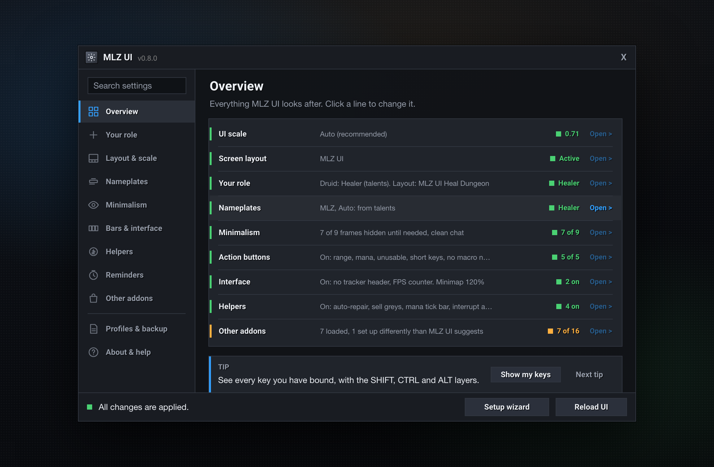
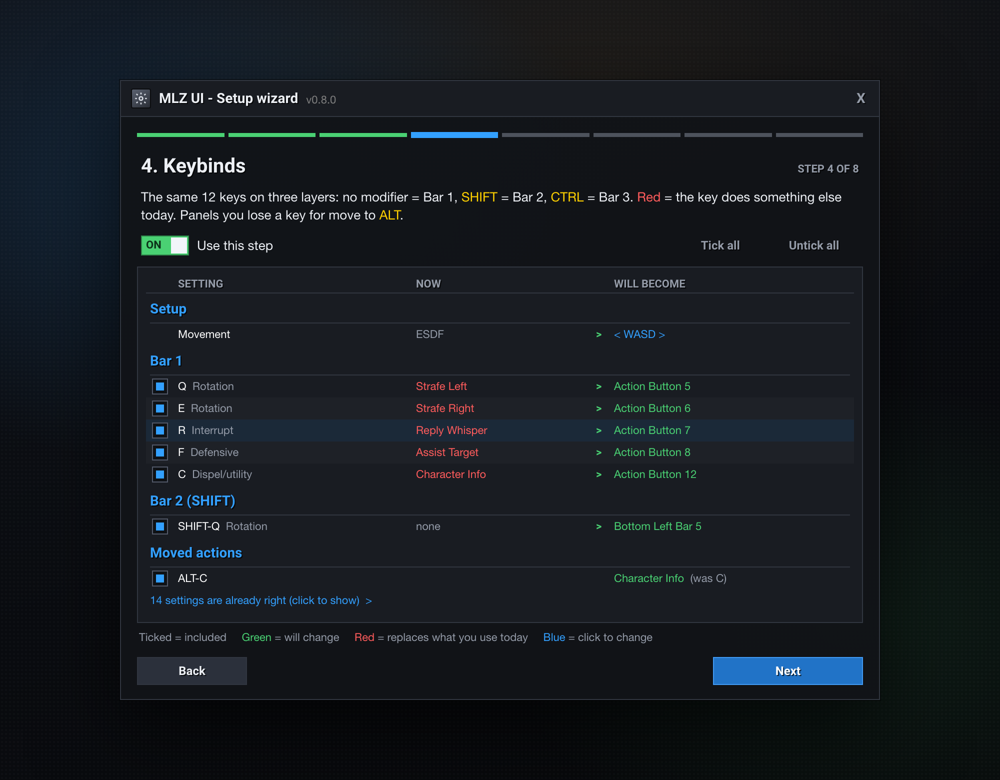
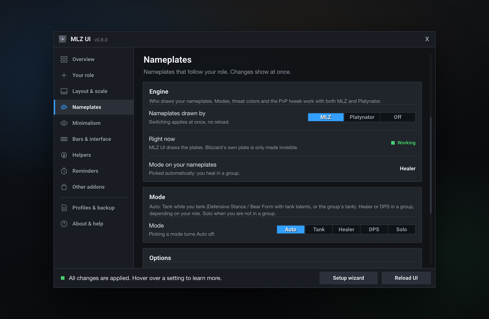
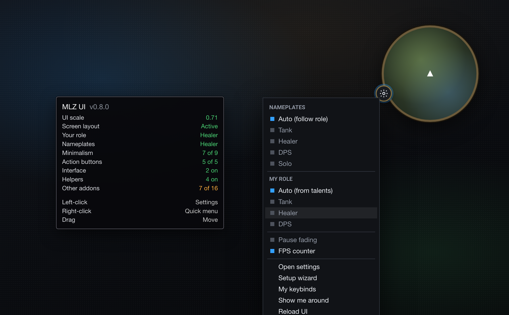

<div align="center">

# MLZ UI

**A clean, minimal World of Warcraft UI in one guided setup. Every change previewed, every change undoable.**




</div>

---

## Why MLZ UI

MLZ UI sets up the **Blizzard UI you already have** (Edit Mode, CVars, keybinds and your existing addons) instead of replacing it the way full UI suites do.

- **Preview first.** A setup wizard shows every change as *now → will become*. You pick what you want.
- **Always reversible.** A backup is taken before anything changes. `/mlz undo` puts it back.
- **No taint, no libraries.** Protected frames are only faded with `SetAlpha`, and anything blocked in combat waits until combat ends. Plain Lua, no external dependencies.
- **Data, not code.** All choices live in plain tables under [`Data/`](Data), so you can change them without touching the logic.

## Screenshots

<table>
  <tr>
    <td width="50%"></td>
    <td width="50%"></td>
  </tr>
  <tr>
    <td align="center"><sub><b>Setup wizard.</b> Every row shows what it is now and what it will become.</sub></td>
    <td align="center"><sub><b>Nameplates.</b> Tank, Healer, DPS and Solo modes that follow your role.</sub></td>
  </tr>
  <tr>
    <td colspan="2"></td>
  </tr>
  <tr>
    <td colspan="2" align="center"><sub><b>Minimap button.</b> A live status summary on hover and a quick menu on right-click.</sub></td>
  </tr>
</table>

<sub>These are interface previews rendered from <a href="docs/mockups"><code>docs/mockups</code></a> with the addon's exact colors, fonts and copy. They will be replaced by in-game captures.</sub>

## Highlights

**Setup**
- Pixel-perfect UI scale, recalculated when your resolution changes
- A dedicated Edit Mode layout. Your other layouts are never touched.
- ESDF or WASD keybinds in three layers (none, Shift, Ctrl), with conflict detection
- Opt-in CVars: auto loot, cast on key down, camera distance and more

**In play**
- Minimalism: bars, bags and menus fade until you hover, and bars dim out of combat
- Action buttons colored by range, mana and usability, with short hotkey labels
- Role detection (talents, spec, group or your choice) that drives the layouts and nameplates
- Our own flat nameplates: health, cast bar, quest marker, your debuffs and threat colors per role
- Auto-repair, sell greys, a mana tick bar and an interrupt announce

**Ecosystem**
- Recommended settings for Prat, Bagnon, Auctionator, DBM, Leatrix and more
- Optional: Platynator as the nameplate engine, with modes per role and a clean style
- Role profiles, export/import strings and a health check for missing addons

## Quick start

1. Download or clone the repo into your AddOns folder:
   ```sh
   cd "/Applications/World of Warcraft/_<flavor>_/Interface/AddOns"   # Windows: C:\Program Files (x86)\World of Warcraft\_<flavor>_\Interface\AddOns
   git clone git@github.com:martinzachariassen/MLZ_UI.git
   ```
2. Start the game or `/reload`. The setup wizard opens on first login.
3. Open the control center at any time with `/mlz` or the minimap button.

> [!NOTE]
> MLZ UI targets `## Interface: 16001`. If your client marks it as out of date, enable *Load out of date AddOns* or update the number in [`MLZ_UI.toc`](MLZ_UI.toc).

## Commands

| Command | What it does |
|---|---|
| `/mlz` | Open the control center |
| `/mlz install` | Open the setup wizard |
| `/mlz undo` | Undo the last wizard run |
| `/mlz role tank\|healer\|dps\|auto` | Set your role for this character |
| `/mlz np auto\|tank\|healer\|dps\|solo` | Nameplate mode (also `engine mlz\|platynator\|off`, `style`, `threat`, `pvp`, `friends`, `save`, `load`, `export`) |
| `/mlz export` · `/mlz import` | Share your choices as a string |
| `/mlz health` | Check which supported addons are installed and loaded |
| `/mlz help` | List every command |

## Supported addons

MLZ UI **configures** these addons when they are installed and loaded. It does not install them.

| Addon | What gets set |
|---|---|
| [Platynator](https://www.curseforge.com/wow/addons/platynator) (optional) | Only when picked as the nameplate engine: role-based modes, clean style, threat colors, PvP tweak, profile save/restore |
| [Prat 3.0](https://www.curseforge.com/wow/addons/prat-3-0) | Timestamps, hidden chat buttons, scroll speed, fade time |
| [Bagnon](https://www.curseforge.com/wow/addons/bagnon) | Columns, darker background, softer item glow, fewer auto-opens |
| [Deadly Boss Mods](https://www.curseforge.com/wow/addons/deadly-boss-mods) | Warnings top center, timers and info frames on the right, slimmer bars |
| [Leatrix Plus](https://www.curseforge.com/wow/addons/leatrix-plus-classic) · [Maps](https://www.curseforge.com/wow/addons/leatrix-maps-classic) | Junk selling, repair, faster loot, hidden minimap icons |
| [Auctionator](https://www.curseforge.com/wow/addons/auctionator) | No splash screen, auto-select next item, remember duration |
| [AtlasLoot Classic](https://www.curseforge.com/wow/addons/atlasloot-classic-edition) | Optionally hide the minimap button |
| [What's Training?](https://www.curseforge.com/wow/addons/whats-training) | Hide known weapon skills, dock beside the trainer |
| [RestedXP Guides](https://www.restedxp.com/) | Lock frames, guide scale, optional fixed column |

Settings that don't exist in your installed version are shown as *not available* and skipped.

<details>
<summary><b>Full feature reference</b></summary>

| Area | What it does |
|---|---|
| **Pixel-perfect scale** | Calculates the scale from screen height (`k * 768 / height`). Stores the *mode*, not the number, and handles scales below Blizzard's 0.64 CVar limit. |
| **Edit Mode layout** | Bars stacked bottom center, player/target flanking, swing timers and cast bar aligned, corners kept for glance-only info. Separate healer layouts for dungeons and raids. |
| **Keybinds** | 12 reach-sorted base keys per movement setup. With WASD, Shift+1/2/3 switch stance or form, and bar 2 buttons 1-3 move to Shift+G/V/T. Displaced actions (e.g. Character panel) move to Alt. |
| **Settings (CVars)** | Each CVar is optional. CVars your client doesn't have are skipped. |
| **Minimalism** | Bars 4-5, micro menu, bags, chat buttons and XP bar hidden until hover. Bars 2-3 dimmed out of combat. Damage meter only in a group. |
| **Action buttons** | Red = out of range, blue = no resource, grey = unusable. Short hotkeys (`S1`, `C1`) and hidden macro names. Stance, pet and bonus bars included. |
| **Nameplates** | MLZ nameplates (or Platynator). Tank / Healer / DPS / Solo picked from your role. Healer: unclickable friendly names, dimmed enemies. Tank: bigger target, your debuffs on every mob. Quest marker, cast bar, level only when it matters. Applies at once, no `/reload`. |
| **Quality of life** | Auto-repair (guild money first), sell greys (hold Shift to skip), mana tick / 5-second rule bar (energy tick for rogues and cats), interrupt announce. |
| **Role profiles** | Nameplates, fading, tick bar and interrupt announce saved per role, loaded automatically when your role changes. |
| **Tweaks** | Minimap size, FPS counter, calmer combat text (Roboto Bold), hide the quest tracker or its header. |
| **Backup / undo** | A stack of up to 5 backups. Every wizard run is reversible. |
| **Health check** | Warns after login if a configured addon is installed but not loaded. |

</details>

<details>
<summary><b>Control center pages</b></summary>

| Page | What you see and change |
|---|---|
| Overview | One status line per area, and a banner only when setup or a reload is pending |
| Layout & scale | Scale mode, screen layout (Edit Mode), minimap size, pet bar position |
| Nameplates | Engine (MLZ, Platynator or off), current mode and why, mode picker, friendly names, threat colors, PvP tweak, what the plates show, size, Platynator profile save/restore |
| Role & healing | Your role and where it comes from, healer layouts now and for your role, rebuild healer layouts |
| Minimalism | One switch per faded frame, pause fading, clean chat |
| Action bars & UI | Button colors and hotkeys, quest tracker, FPS counter, combat text |
| Quality of life | Repair / sell greys, mana tick bar, interrupt announce |
| Other addons | Which supported addons are loaded and how many settings differ |
| Profiles & backup | Role profiles, export/import, backups, undo |
| About & help | How it works, minimap button, commands, debug |

The footer always shows whether a reload is needed and why.

</details>

<details>
<summary><b>Customizing</b></summary>

Everything the wizard offers is defined in `Data/`:

| File | Controls |
|---|---|
| [`Data/CVars.lua`](Data/CVars.lua) | Game settings |
| [`Data/Bindings.lua`](Data/Bindings.lua) | Movement setups, base keys, layers, stance and pet keys |
| [`Data/Layout.lua`](Data/Layout.lua) | Edit Mode frame positions |
| [`Data/Fade.lua`](Data/Fade.lua) | What fades, when and how much |
| [`Data/Nameplates.lua`](Data/Nameplates.lua) | Nameplate modes, PvP tweak, threat colors, MLZ nameplate sizes and colors |
| [`Data/Addons.lua`](Data/Addons.lua) | Settings applied to other addons |

</details>

## Roadmap

- [x] Setup wizard with preview and undo
- [x] Control center, minimap button and role profiles
- [x] Interface previews in this README
- [ ] In-game screenshots and a short demo
- [ ] **Addon manager**: installed / missing / outdated state for supported addons
- [ ] Install and update supported addons through a small companion app (the game's Lua sandbox can't write files)
- [ ] Version-aware settings for other addons
- [ ] Packaged releases on CurseForge, Wago and GitHub Releases

## Contributing

Issues and pull requests are welcome, especially settings for more addons (start in [`Data/Addons.lua`](Data/Addons.lua)), bug reports with `/mlz probe` output and the Lua error text, and layout or keybind ideas.

- How the code fits together: [`docs/ARCHITECTURE.md`](docs/ARCHITECTURE.md)
- Conventions, design language and workflow: [`CLAUDE.md`](CLAUDE.md)

For development, symlink the folder into AddOns, turn on `/mlz debug` and install [BugGrabber + BugSack](https://www.curseforge.com/wow/addons/bugsack).

## License

No license has been added yet. Until one is, all rights are reserved by the author. Roboto is licensed under the Apache License 2.0 (see [`Media/Roboto-LICENSE.txt`](Media/Roboto-LICENSE.txt)).

## Credits

Inspired by [ElvUI](https://github.com/tukui-org/ElvUI), [Bartender4](https://www.curseforge.com/wow/addons/bartender4), [Dominos](https://www.curseforge.com/wow/addons/dominos), [tullaRange](https://www.curseforge.com/wow/addons/tullarange) and [AutoBar](https://www.curseforge.com/wow/addons/autobar).

Made by [Martin](https://github.com/martinzachariassen).
